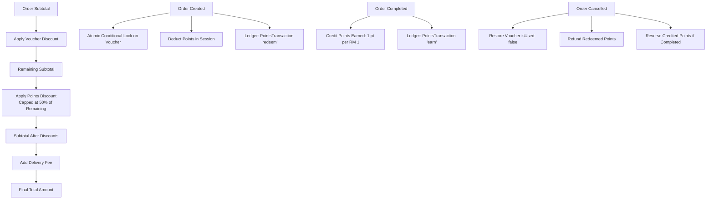

# SoulTalk Pastry — Phase 5 Handover Report & Manual Testing Checklist

**Phase:** Phase 5 — Points and Vouchers Working at Checkout  
**Status:** ✅ Completed & Fully Verified  
**Date:** October 20, 2026  
**Test Suite:** 101 / 101 tests passing (`vitest`) + Live MongoDB Atlas Verification Suite  

---

## 1. Phase 5 Overview & Deliverables

Phase 5 introduces a production-ready **Points and Vouchers Engine** seamlessly integrated into SoulTalk Pastry's storefront checkout, order lifecycle, member center, and admin console.

### Key Systems Built

---

## 2. Technical Architecture & Rule Specifications

### 2.1 Points Engine
1. **Dynamic Rules from Store Settings**:
   - `points_earn_ratio`: Default `1` (1 point earned per RM 1 spent).
   - `points_redeem_ratio`: Default `0.01` (100 points = RM 1.00 redemption credit).
   - `points_min_redeem`: Default `100` (minimum 100 points required to redeem).
   - `points_max_order_share_percent`: Default `50` (maximum 50% of order payable via points).
   - `points_credit_event`: Default `order_completed` (points credited when order is marked completed).
   - *Admin editable*: Configurable via Admin Store Settings (`/admin/settings`).
2. **Double-Entry Ledger (`PointsTransaction`)**:
   - Every points change is recorded with `type` (`earn`, `redeem`, `adjust`, `refund`), `amount`, `balanceAfter`, `description`, `relatedOrder`, `createdBy`, and timestamps.
   - Atomically updates `member.pointsBalance` and creates the ledger entry.
   - **Strict Non-Negative Balance Guard**: Deductions that would reduce balance below zero throw a `400 Bad Request` and abort the transaction.
3. **Admin Points Adjustments**:
   - Admin can manually credit or debit points with a **mandatory reason** via `/admin/members` (Award icon modal) or `POST /api/v1/admin/points/adjust`.
4. **Lifecycle Reversals**:
   - Cancelling an order automatically refunds redeemed points back to the member.
   - If an order was previously completed and then cancelled/refunded, credited earned points are reversed.

### 2.2 Vouchers Engine
1. **Voucher Configurations**:
   - Fixed RM amount or Percentage discount.
   - Minimum spend requirements (`minOrderAmount`).
   - Maximum discount cap for percentage vouchers (`maxDiscount`).
   - Validity windows (`validFrom`, `validUntil`, or `validDays`).
   - Global usage limits (`totalUsageLimit`) and per-member limits (`perMemberLimit`).
2. **Issuance System**:
   - Admin can issue vouchers to **All Active Members** or **Specific Selected Members** via `/admin/vouchers`.
   - Creates individual `MemberVoucher` records tracking usage state, expiry, and linked order.
3. **Atomic Concurrency Protection**:
   - `applyVoucherInTransaction` uses MongoDB's atomic `findOneAndUpdate` with condition `{ _id, isUsed: false, expiresAt: { $gt: now } }`.
   - Simultaneous checkout requests attempting to use the same voucher result in exactly one successful order and the second request failing with `400 Bad Request ("Voucher has already been used")`.
4. **Cancellation Restoration**:
   - Cancelling an order restores the voucher (`isUsed = false`, `usedAt = null`, `usedInOrder = null`) if it has not expired.

### 2.3 Discount Combination Sequence
1. **Voucher First**: Voucher discount is calculated against order items subtotal.
2. **Points Second**: Points discount is calculated against the remaining subtotal, capped at `maxOrderSharePercent` (50%).
3. **Total Calculation**:
   $$\text{Total} = \max(0, \text{Subtotal} - \text{VoucherDiscount} - \text{PointsDiscount}) + \text{DeliveryFee}$$
4. **Order Snapshot**: `Order` stores `subtotal`, `deliveryFee`, `voucherDiscount`, `pointsDiscount`, `voucherCode`, `pointsEarned`, `pointsRedeemed`, and `totalAmount`.

---

## 3. UI Implementation Details

### Storefront & Member Center
- **Checkout Page (`/checkout`)**:
  - Interactive voucher selector displaying all available member vouchers with computed savings.
  - Custom voucher promo code input with instant server-side validation.
  - Interactive points redemption slider and numeric input with "Redeem Max" button and 50% cap indicator.
  - Live Order Summary showing itemized Subtotal, Delivery Fee, Voucher Discount, Points Discount, Total, and Estimated Points to earn.
- **Order Confirmation Page (`/orders/confirmation/:id`)**:
  - Itemized receipt breakdown showing voucher code used and points redeemed.
- **Member Center (`/account`)**:
  - **Points Tab**: Real-time points balance, estimated cash value, redemption rules breakdown, and comprehensive audit history ledger with colored badges (+/- amounts, timestamps, and order links).
  - **Vouchers Tab**: Categorized wallet with tabs for **Available**, **Used**, and **Expired** vouchers, discount tags, minimum spend badges, and copy-to-clipboard code buttons.
  - **Order Cancellation**: Pending orders can be cancelled with one click, showing a reminder that points and vouchers will be restored.

### Admin Console
- **Voucher Management (`/admin/vouchers`)**:
  - Table of all voucher definitions with code, discount, min spend, usage count / limits, validity, and active toggle.
  - **Create / Edit Voucher Modal**: Full configuration controls.
  - **Issue Voucher Modal**: Target "All Active Members" or search and multi-select individual members.
- **Member Management (`/admin/members`)**:
  - Dedicated "Adjust Points (Ledger)" modal on every member row.
  - Mandatory reason field with quick preset buttons ("Goodwill gesture", "Order compensation", "VIP anniversary").
  - Live new balance preview preventing negative values.
- **Store Settings (`/admin/settings`)**:
  - Admin editable points earn ratio, redeem ratio, min redeem points, and max order share percent.

---

## 4. Test Verification Summary

### Automated Test Suite (`server/src/__tests__/points_vouchers.test.ts`)
- **13 Specialized Points & Vouchers Tests** (part of 101 total passing server tests):
  1. *Points discount calculation and 50% order share cap enforcement.*
  2. *Minimum redeem points rule enforcement.*
  3. *Rejection of points redemption exceeding current member balance.*
  4. *Negative balance prevention in points ledger.*
  5. *Combination sequence: voucher first, then points on remaining.*
  6. *Voucher minimum spend enforcement.*
  7. *Voucher expiry date validation.*
  8. *Concurrency test: simultaneous double voucher checkout requests (one 201, one 400).*
  9. *Concurrency test: simultaneous double points redemption exceeding balance (second rejected).*
  10. *Order cancellation restores redeemed points and marks voucher unused.*
  11. *Order cancellation reverses earned points if order was marked completed.*
  12. *Admin voucher creation and issuance to all members.*
  13. *Admin manual points adjustment with mandatory reason and ledger recording.*

### Live Environment Verification Script (`server/src/verify_phase5.ts`)
- Executed against live MongoDB Atlas:
  - Settings rules loaded: earn ratio 1, redeem ratio 0.01, min redeem 100, max share 50%.
  - Member Alice Tan points adjustment and ledger recording verified.
  - Voucher creation and issuance to member wallet verified.
  - Discount math and combination calculation verified.
  - Atomic conditional lock and double-spend blocking verified.
  - Order cancellation and voucher restoration verified.

---

## 5. Manual Testing Checklist for User

Use this step-by-step checklist to test the complete user and admin experience:

### Step 1: Admin Creates & Issues a Voucher
1. Open [http://localhost:5173/login](http://localhost:5173/login).
2. Sign in as Admin:
   - Email: `admin@soultalkpastry.com`
   - Password: `admin123`
3. Click **Vouchers** in the sidebar (or go to [http://localhost:5173/admin/vouchers](http://localhost:5173/admin/vouchers)).
4. Click **Create New Voucher**:
   - Code: `CELEBRATE20`
   - Display Name: `20% Off Celebration Treat`
   - Type: `Percentage (%) Discount`
   - Value: `20`
   - Min Spend: `50`
   - Max Discount Cap: `40`
   - Save the voucher.
5. In the table, click **Issue** on `CELEBRATE20`:
   - Select **All Active Members** -> Click **Confirm & Issue**.
   - Verify success notification confirms wallets credited.

### Step 2: Admin Adjusts Member Points
1. Go to **Members & Import** ([http://localhost:5173/admin/members](http://localhost:5173/admin/members)).
2. Find **Alice Tan** (`+60121111111`).
3. Click the **Adjust Points (Ledger)** icon (award medal icon):
   - Amount: `150`
   - Reason: `VIP Customer Loyalty Bonus`
   - Click **Save & Record in Ledger**.
4. Verify Alice's points balance increases by 150.

### Step 3: Member Views Points Ledger & Voucher Wallet
1. Sign out of Admin.
2. Sign in as Member Alice Tan:
   - Email: `alice@example.com`
   - Password: `member123`
3. Navigate to **Member Center** ([http://localhost:5173/account](http://localhost:5173/account)).
4. Click the **Points** tab:
   - Verify current points balance and cash equivalent.
   - Verify transaction history shows the `VIP Customer Loyalty Bonus` (+150 pts) with timestamp.
5. Click the **Vouchers** tab:
   - Verify `CELEBRATE20` is listed under **Available** with 20% OFF and min spend RM 50.

### Step 4: Checkout with Combined Voucher & Points
1. Go to **Catalog** ([http://localhost:5173/products](http://localhost:5173/products)).
2. Add **Signature Velvet Bloom Cake** (RM 128.00) to the cart.
3. Proceed to **Checkout** ([http://localhost:5173/checkout](http://localhost:5173/checkout)).
4. Select Fulfillment: **Store Self-Pickup** and choose a pickup slot.
5. In the **Member Vouchers** section:
   - Select `CELEBRATE20` (20% OFF).
   - Verify voucher discount shows `-RM 25.60` (20% of RM 128).
6. In the **Redeem Member Points** section:
   - Enter `200` points (or click "Redeem Max").
   - Verify points discount shows `-RM 2.00`.
7. Review the **Order Summary**:
   - Subtotal: `RM 128.00`
   - Voucher Discount (`CELEBRATE20`): `-RM 25.60`
   - Points Discount (`200 pts`): `-RM 2.00`
   - Total Amount: `RM 100.40`
8. Choose payment method **Pay in Store** and click **Confirm & Place Order**.
9. On the **Order Confirmation** page, verify full itemization matches the checkout summary.

### Step 5: Verify Ledger Updates & Order Cancellation
1. Go back to [http://localhost:5173/account](http://localhost:5173/account).
2. Check the **Points** tab:
   - Verify points balance decreased by 200.
   - Verify a new `redeem` entry exists: `-200 pts (Redeemed 200 points on Order #...)`.
3. Check the **Vouchers** tab:
   - Verify `CELEBRATE20` moved from **Available** to **Used**.
4. In the **Orders** tab, click **View Details** on the latest order.
5. Click **Cancel Order** and confirm cancellation:
   - Order status updates to `cancelled`.
6. Re-check the **Points** tab:
   - Verify `+200 pts` was refunded with description `Refund 200 redeemed points from cancelled Order #...`.
7. Re-check the **Vouchers** tab:
   - Verify `CELEBRATE20` is restored back to the **Available** tab!
